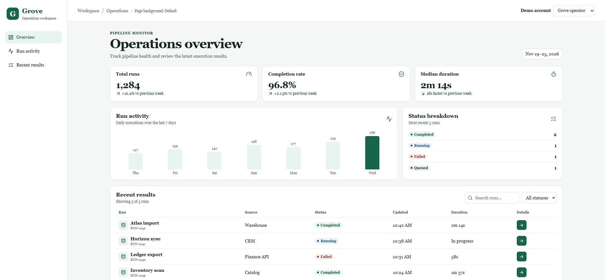
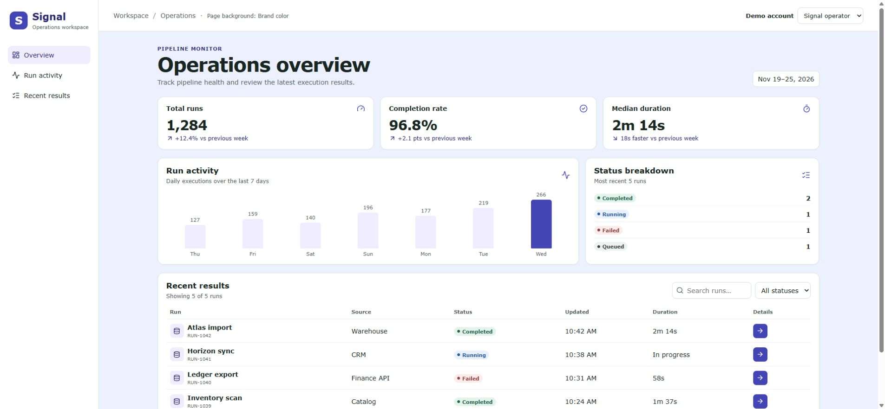
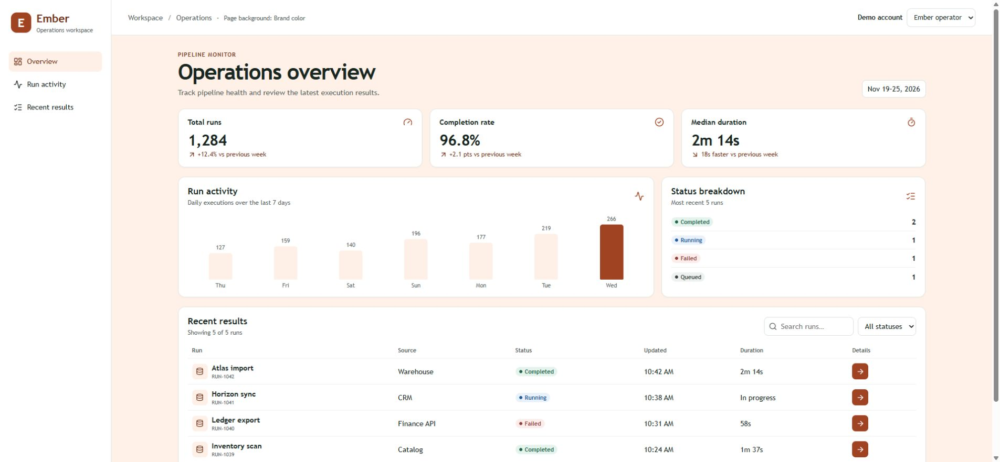

# Personal React + TypeScript Playground

같은 조건에서 React 구현 후보를 비교하고 로컬 검증 근거를 기록하는 저장소입니다.

## 실험

| 실험 | 문제 | 확인한 결과 | 로컬 화면 경로 | 기준 측정 |
|---|---|---|---|---|
| 브랜드 테마 | 공통 디자인 토큰을 유지하면서 계정별 색상·글꼴·배경을 바꿀 때 수정 비용과 브라우저 비용이 얼마나 드는가? | CSS Modules와 styled-components는 모달 토큰 연결을 각각 1곳, Tailwind 계열은 2곳 수정했습니다. styled-components는 새 브랜드를 처음 적용할 때 CSS 규칙 73개를 더 만들었고, 후보별 빌드 시간 범위는 겹쳤습니다. [브랜드 테마 결과](docs/experiments/brand-theme/results.md) | `/experiments/brand-theme/` | `npm run measure` |
| 대시보드 결과 자동 조회 | 폴링 요청을 줄일 때 완료 표시는 얼마나 늦어지고, 중간 상태는 얼마나 누락되는가? | 정상에서 고정 1초 → 3초로 늘리면 평균 요청은 작업당 14.0 → 5.7건, 완료 p95는 524 → 2,105ms였습니다. SSE 반영 p95는 75ms였고 누락은 없었습니다. [자동 조회 결과](docs/experiments/dashboard-refresh/results.md) | `/experiments/dashboard-refresh/` | `npm run measure:refresh` |
| Jonbeo MSW | 워커 준비 대기가 초기 화면과 로딩 후 클릭 반응에 각각 어떤 영향을 주는가? | 원본 개발 서버에서 워커 대기를 제거하자 제목 DOM 등장이 6.44초 → 0.34초로 줄었습니다. 로딩 후 INP 개선은 확인되지 않았고, 가장 오래 걸린 구간은 클릭 이벤트 처리였습니다. [Jonbeo MSW 결과](docs/experiments/jonbeo-msw/results.md) | `/experiments/jonbeo-msw/` | `npm run measure:msw` |

세 실험의 자료와 공통 기록 기준은 [실험 문서](docs/experiments/README.md)에서 볼 수 있습니다.

## 로컬 실행

Node.js 24와 Google Chrome을 사용했습니다.

```sh
npm ci
npm run dev
```

Vite가 출력한 주소에서 실험을 선택합니다. 위 표의 경로를 그 주소에 붙여 바로 열 수도 있습니다.

각 실험의 상단에 **문제 · 확인한 결과 · 판단**이 나옵니다. 이어서 **선택지 → Playground → 결론 → 검증 결과** 순서로 볼 수 있으며, 상단에서 각 섹션과 다른 실험으로 이동할 수 있습니다.

- **Brand style runtime**에서 후보별 주입 코드를 비교합니다. 페이지 안의 CSS Modules 대시보드 또는 **Playground 전체 화면 열기**에서 **Demo account**를 바꿔 Grove, Signal, Ember를 전환할 수 있습니다. **Signed out**을 고르면 기본 브랜드가 적용됩니다.
- **Dashboard auto refresh**에서 **Update method**는 작업을 가져오는 방식, **Next run scenario**는 다음 작업의 서버 전달 조건을 고릅니다. 시나리오를 바꾸면 기존 측정표가 갱신되고, **Start run**을 누르면 별도로 실제 관측 목록을 볼 수 있습니다.
- **Jonbeo MSW performance**에서 **Request path**와 **Initial rendering**을 각각 바꿔 볼 수 있습니다. 하단에서 동일한 응답을 사용한 플레이그라운드 결과와 원본 Next.js 개발 서버의 게이트 제거 전후 결과를 확인합니다.

## 브랜드 테마 화면

CSS Modules 대시보드의 배경색, 강조색, 글꼴을 브랜드별로 비교할 수 있습니다. 상단의 **Page background**는 배경의 적용 출처를 표시합니다. 이미지를 누르면 원본을 볼 수 있습니다.

| Grove · 공통 배경 | Signal · 브랜드 배경 | Ember · 브랜드 배경 |
|---|---|---|
| [](screenshots/grove.jpg) | [](screenshots/signal.jpg) | [](screenshots/ember.jpg) |

브랜드 적용 우선순위는 **데모 계정 브랜드 → 유효한 환경 변수 → Grove**입니다. 기본 브랜드를 바꾸려면 [환경 변수 예시](.env.example)를 참고해 `.env.local`에 `VITE_DEFAULT_BRAND=signal` 등을 설정합니다. 프로덕션 빌드의 기본값을 바꾸려면 다시 빌드합니다.

## 검증 및 측정

```sh
npm test
npm run build
```

테스트는 설치된 Chrome을 새 테스트 컨텍스트에서 실행합니다. 빌드 후 표에서 필요한 측정 명령을 실행합니다. 각 명령은 `dist`로 로컬 미리보기 서버를 열고 결과를 저장합니다.

| 측정 명령 | 출력 |
|---|---|
| `npm run measure` | `test-results/theme-benchmark.json` 및 후보별 대시보드 캡처 |
| `npm run measure:refresh` | `test-results/dashboard-refresh.json` |
| `npm run measure:msw` | `test-results/jonbeo-msw/results.json` |

Jonbeo 결과 문서에 [Chrome trace 수집](docs/experiments/jonbeo-msw/results.md#chrome-trace-수집)과 [원본 클론 측정](docs/experiments/jonbeo-msw/results.md#jonbeo-원본-측정) 절차도 있습니다.

## 저장소 구조

- [실험 코드](experiments/)는 `experiments/<주제>/`에 자체 진입점을 두고 하나의 npm 패키지로 의존성을 관리합니다.
- [공통 실험 레이아웃](experiments/shared/ExperimentPage.tsx)이 제목, 실험 요약, 페이지 이동, 섹션, 선택지 목록, 검증 표의 구조를 제공합니다.
- [브랜드 디자인 시스템](experiments/brand-theme/shared/design-system/)의 `tokens.ts`는 공통값, `brands.ts`는 브랜드별 변경값, `theme.ts`는 네 후보가 받는 최종 테마와 CSS 변수 매핑을 정의합니다. 각 후보는 자체 HTML과 스타일 진입점을 가지며 Tailwind와 shadcn/ui는 유틸리티 정의를 공유합니다.
- [실험 문서](docs/experiments/)는 코드와 같은 주제 이름의 폴더에 `results.md`와 측정 원본을 둡니다.
