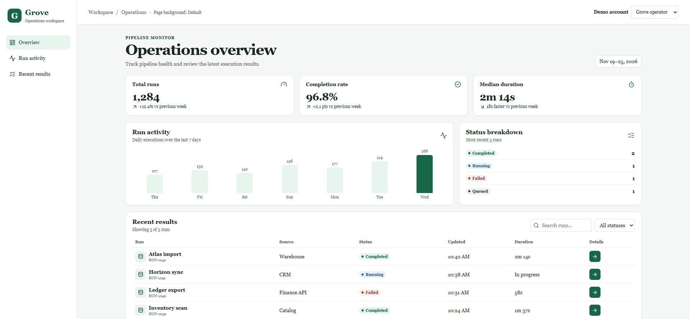
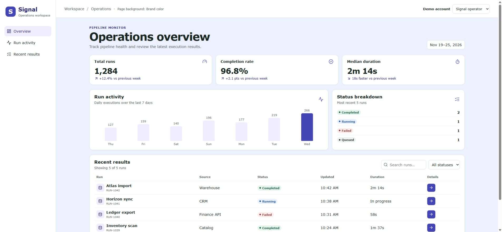
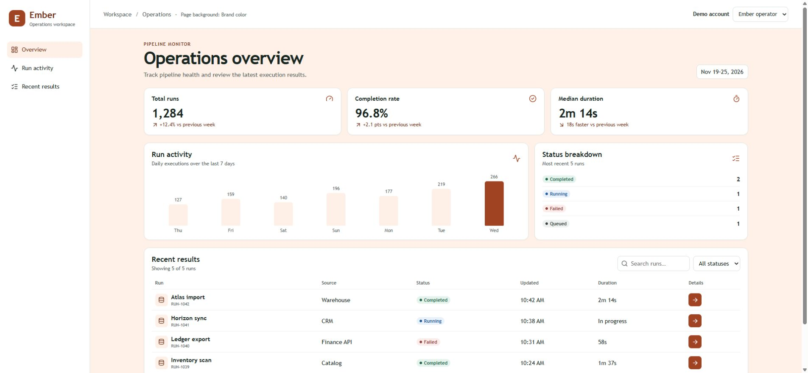

# 브랜드 테마 실험 지침

[실험 목차](../README.md) · [공통 지침](../../../AGENTS.md) · [결과 보고서](results.md) · [빌드·개발 반영·런타임 상세](build-runtime.md) · [측정 원본](evidence/)

## 비교 설계

공통 디자인 토큰을 유지하면서 브랜드의 색상·글꼴·배경만 바꿀 때 구현과 유지보수 비용이 어떻게 다른지 봅니다. **CSS Modules + React Context, styled-components, styled-components + CSS 변수, Tailwind CSS, shadcn/ui**가 같은 토큰과 대시보드를 사용합니다. 달라지는 부분은 각 후보에서 토큰을 CSS나 스타일 함수에 연결하는 방식입니다.

- 토큰은 공통 기본값과 브랜드별 오버라이드를 합쳐 결정합니다. 브랜드 선택 우선순위는 **데모 계정 → 유효한 `VITE_DEFAULT_BRAND` → Grove**입니다. [계정과 우선순위](../../../experiments/brand-theme/shared/brands.ts) · [디자인 토큰](../../../experiments/brand-theme/shared/design-system/)
- 동일한 색상 변경과 모달 테두리 토큰 추가를 다섯 후보에 각각 적용합니다. 공통 준비 작업과 후보별 파일·수정 지점, 패치 적용·첫 반영·전체 확인 시간을 따로 기록합니다.
- 초기 JS·CSS gzip 자산, Vite 빌드, 개발 중 색상 반영, 브랜드 전환 후 계산된 스타일과 CSSOM 규칙을 비교합니다. 프레임 단위 스타일 정착 시간에는 버튼 애니메이션이 반영될 수 있습니다.

## 화면에서 확인하기

[공통 실행 절차](../../../README.md#로컬-실행)로 서버를 켜고 [Brand style runtime](http://127.0.0.1:5173/experiments/brand-theme/#playground)을 엽니다. **Demo account**에서 Grove, Signal, Ember와 **Signed out**을 차례로 선택합니다. **Page background**의 적용 출처, 글꼴, 상세 버튼 색과 모달을 확인합니다. 네 후보의 개별 화면은 [코드 예제 구간](http://127.0.0.1:5173/experiments/brand-theme/#options)과 [후보별 진입점](../../../experiments/brand-theme/)에서 확인할 수 있습니다.

Grove는 공통 배경, Signal과 Ember는 각 브랜드 지정 배경을 사용합니다. 로그아웃 시 기본 브랜드를 바꾸려면 [환경 변수 예시](../../../.env.example)를 참고해 `.env.local`을 설정합니다. 프로덕션 화면에는 다시 빌드한 뒤 반영됩니다.

| Grove · 공통 배경 | Signal · 브랜드 배경 | Ember · 브랜드 배경 |
|---|---|---|
| [](../../../screenshots/grove.jpg) | [](../../../screenshots/signal.jpg) | [](../../../screenshots/ember.jpg) |

## 재실행과 원본

저장소 루트에서 실행합니다.

```sh
npm test -- tests/brand-theme.spec.ts --workers=1
npm run build
npm run measure
node scripts/measure-theme-build.mjs
node scripts/measure-theme-change.mjs
node scripts/measure-theme-change.mjs --watch
```

| 확인 대상 | 원본과 출력 |
|---|---|
| 브랜드 전환과 번들 | `npm run measure`의 `test-results/theme-benchmark.json`과 캡처가 로컬에 생성됩니다. 보고서에 [요약 표](results.md#브라우저와-빌드)가 있습니다. |
| Vite 빌드 | [후보별 7회 기록](evidence/theme-build-benchmark.json) |
| 개발 중 색상 변경 | [후보별 3회 기록](evidence/theme-dev-edit-benchmark.json) |
| 모달 테두리 토큰 추가 | [후보별 3회 기록](evidence/brand-outline-benchmark.json) |
| macOS 재측정(다섯 후보) | [번들·브랜드 전환·CSSOM](evidence/macos-theme-benchmark.json) · [빌드](evidence/macos-theme-build.json) · [모달 토큰](evidence/macos-brand-outline-benchmark.json) · [개발 중 색상 수정](evidence/macos-dev-edit-benchmark.json) |
| 브랜드 전환에서 CSSOM에 추가된 규칙 | [스타일 규칙 기록](evidence/theme-runtime-style-rules.json) |

Chrome 회귀 검사는 공통값과 브랜드 오버라이드, 로그인·로그아웃, 모달 포커스와 모바일 스크롤을 다룹니다. 파일별 사용 위치와 실제 파일 변경량은 [결과 보고서](results.md)에, 초기 구현 당시 작업 맥락은 [기존 계획](../../superpowers/plans/2026-11-25-brand-theme-lab.md)에 있습니다.

[대시보드 실시간 갱신 실험](../dashboard-refresh/README.md)은 이 화면의 CSS Modules 테마와 공통 대시보드를 사용합니다.
